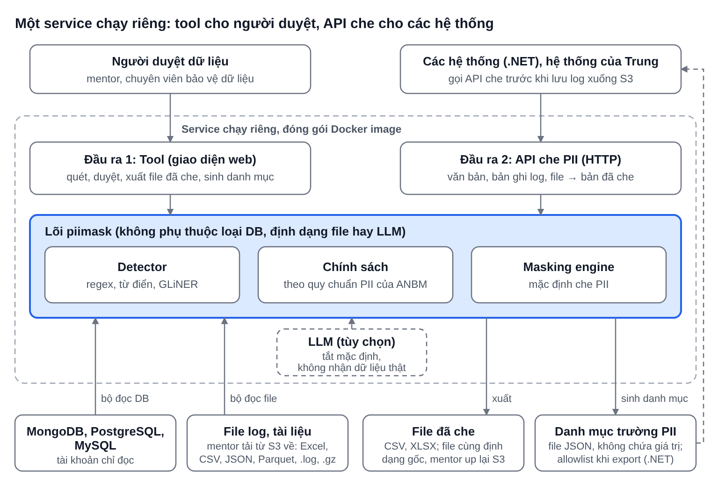

# Gate 0 – Kế hoạch bài toán phát hiện và che PII (Cặp A – Đoàn Tuấn Long)

02/11/2026 · Đoàn Tuấn Long

## 1. Vấn đề

Dữ liệu doanh nghiệp (báo cáo, log hệ thống, tài liệu) chứa thông tin cá nhân, nhưng chưa có cách chuẩn để phát hiện và che thông tin này trước khi chia sẻ cho người khác hoặc lưu vào hệ thống khác.

Rà soát thủ công vừa chậm vừa dễ sót. Bộ phận an ninh bảo mật (ANBM) quét toàn bộ bucket S3 và đánh lỗi các log, tài liệu chứa PII, trong khi log không cần thể hiện thông tin cá nhân. Bài toán là xây dựng MVP tự động phát hiện và che PII (CCCD, số điện thoại, email, địa chỉ, ngày sinh, mã số thuế, họ tên) trên cơ sở dữ liệu MongoDB, PostgreSQL, MySQL và trên file log, tài liệu bị đánh lỗi trên S3 (Excel, CSV, JSON, Parquet, file log .log kể cả dạng nén .gz).

Theo góp ý của mentor, không nhúng lõi trực tiếp vào code của các hệ thống. MVP là một service chạy riêng, đóng gói Docker, có hai đầu ra dùng chung một lõi che PII:

1.  **Tool** cho người duyệt: quét DB và file, duyệt cách xử lý, xuất dữ liệu đã che; sinh **danh mục trường PII** dạng JSON cho toàn bộ collection hoặc bảng; che các file đã bị đánh lỗi (mentor tải file từ S3 về, chạy qua tool, rồi up lại).

2.  **API che PII** cho các hệ thống: gọi trước khi lưu log mới xuống S3 để nhận lại bản đã che.

PII phát hiện được mặc định che, theo quy chuẩn PII của ANBM. Log được ghi dạng object và có thể chứa PII, nên log thuộc phạm vi MVP; nghiên cứu mở rộng thực hiện sau MVP.

## 2. Người dùng

| Nhóm                                                     | Làm gì                                                                                                                                                                                                                                      | Dùng khi nào                                             |
|----------------------------------------------------------|---------------------------------------------------------------------------------------------------------------------------------------------------------------------------------------------------------------------------------------------|----------------------------------------------------------|
| Người duyệt dữ liệu (mentor, chuyên viên bảo vệ dữ liệu) | Dùng tool: kết nối MongoDB, PostgreSQL, MySQL hoặc đưa vào file tải từ S3 về; chọn collection, bảng, truy vấn hoặc file cần quét; xem kết quả, duyệt cách xử lý, xuất file đã che; sinh danh mục trường PII; che file bị đánh lỗi để up lại | Trước khi chia sẻ dữ liệu; khi ANBM đánh lỗi PII trên S3 |
| Đội phát triển các hệ thống (.NET)                       | Gọi API che trước khi lưu log xuống S3; hoặc dùng file danh mục trường PII (JSON) làm allowlist khi export và để tự viết lib lọc dữ liệu                                                                                                    | Mỗi lần ghi log mới hoặc export dữ liệu                  |
| Hệ thống của Trung (OCR VGP/CPO, chatbot FAQ)            | Gọi API che để làm sạch văn bản trước khi lưu hoặc gửi đi                                                                                                                                                                                   | Mỗi lần xử lý văn bản có thể chứa PII                    |

## 3. Giá trị mang lại

MVP thay bước rà soát tay bằng quy trình tự động có người duyệt, và cho các hệ thống một cách che PII ngay trước khi lưu.

- **Giảm sót PII:** phát hiện theo tên trường, nội dung giá trị và nhận diện thực thể trong văn bản tự do, đo bằng recall trên bộ mockup có nhãn.

- **Log mới sạch PII ngay từ lúc lưu:** hệ thống gọi API che trước khi lưu xuống S3; file cũ đã bị ANBM đánh lỗi được tải về, che bằng tool rồi up lại.

- **Không phải nhúng lõi vào code:** các hệ thống .NET chỉ cần gọi API hoặc đọc file danh mục trường PII; một danh mục dùng lại được cho nhiều hệ thống.

- **Rút ngắn thời gian:** mục tiêu tối đa 10 phút để quét và che một dataset; mức tiết kiệm so với rà tay sẽ đo ở Gate 1.

- **Giữ dữ liệu dùng được:** HMAC giữ khóa nối giữa các collection hoặc bảng; với trường văn bản chỉ che phần PII, phần còn lại giữ nguyên; log và file đã che giữ nguyên cấu trúc, định dạng và kiểu dữ liệu.

## 4. Phạm vi

MVP gồm tool và API che PII, chạy chung một service riêng đóng gói Docker. Các nội dung khác nằm ngoài phạm vi và sẽ phát triển sau.

**Trong phạm vi (MVP)**

- Kết nối MongoDB, PostgreSQL, MySQL bằng chuỗi kết nối (URI) với tài khoản chỉ đọc; chọn collection, bảng hoặc viết truy vấn để quét.

- Nhận file Excel, CSV, JSON, Parquet, .log, .gz do người dùng tải từ S3 về rồi đưa vào tool (một hoặc nhiều file một lượt); tool không kết nối trực tiếp tới S3.

- Phát hiện PII ở dữ liệu có cấu trúc (theo trường hoặc cột, kể cả trường lồng nhau) và văn bản tự do (regex, từ điển, GLiNER); trường tên mơ hồ được nhận diện theo nội dung; với log object, duyệt đệ quy theo đường dẫn trường và xử lý chuỗi JSON lồng trong trường; với file Excel, CSV, JSON, Parquet, đọc theo sheet, cột và kiểu dữ liệu; với file .log và .gz, giải nén khi cần rồi quét từng dòng theo nội dung, dòng nào là JSON thì xử lý như log object.

- **Danh mục trường PII:** quét toàn bộ collection hoặc bảng, xuất file JSON ghi đường dẫn trường, loại PII, độ tin cậy và hành động đề xuất; không chứa giá trị thật. File này là đầu vào cho allowlist khi export trong .NET và là căn cứ để các hệ thống tự viết lib lọc dữ liệu.

- **API che PII qua HTTP:** nhận văn bản, bản ghi (object, dòng log) hoặc file và trả lại bản đã che giữ nguyên cấu trúc; các hệ thống gọi trước khi lưu log xuống S3.

- **Xử lý file đã bị ANBM đánh lỗi** (theo hướng của mentor): mentor tải file từ S3 về, tool che và xuất lại file cùng định dạng, sau đó mentor up lại lên S3; tool không đọc hay ghi trực tiếp trên S3.

- PII phát hiện được mặc định che, theo quy chuẩn PII của ANBM; người duyệt có thể chọn hành động cho từng trường (MASK, PARTIAL, HMAC, REDACT, DROP, KEEP) và chính sách theo giá trị của trường khác (ví dụ mã số thuế chỉ che khi khách hàng là cá nhân).

- Xuất dữ liệu DB thành file CSV hoặc XLSX đã che, mảng lồng nhau tách thành file con có khóa cha đã HMAC; file log, tài liệu xuất lại cùng định dạng, giữ nguyên tên cột, kiểu dữ liệu, số dòng; file .gz được nén lại sau khi che.

- Đóng gói tool và API trong một Docker image, chạy như service riêng.

**Ngoài phạm vi**

- Dữ liệu thật dưới mọi hình thức.

- Nhúng lõi trực tiếp vào code của các hệ thống .NET; viết lib .NET dựa trên danh mục (các hệ thống tự làm).

- Cơ sở dữ liệu khác ngoài MongoDB, PostgreSQL, MySQL.

- Kết nối, quét hoặc ghi trực tiếp trên S3; quét tự động theo lịch hoặc theo sự kiện trên bucket.

- Xử lý che PII trên ảnh và OCR.

- Bắt buộc dùng LLM: LLM chỉ là tùy chọn và tắt mặc định.

## 5. Success metric

Các chỉ số đo được, ngưỡng theo chỉ tiêu đề xuất, chờ mentor duyệt, baseline đo ở Gate 1.

| Chỉ số                                                                             | Mục tiêu                                    | Cách đo                                                                                                                                                                           | Dữ liệu               |
|------------------------------------------------------------------------------------|---------------------------------------------|-----------------------------------------------------------------------------------------------------------------------------------------------------------------------------------|-----------------------|
| Recall PII mức nhạy cảm cao                                                        | ≥ 95%                                       | So kết quả quét với file nhãn chuẩn của bộ mockup (DB, log và file)                                                                                                               | Mockup có nhãn        |
| Precision theo trường                                                              | ≥ 90%                                       | Precision = 1 − (số trường bị đánh dấu PII nhưng nhãn chuẩn là không PII ÷ tổng số trường được đánh dấu PII); các trường dễ bị nhầm gồm mã vận đơn 12 số, mã số thuế doanh nghiệp | Mockup có nhãn        |
| Độ chính xác của danh mục trường PII                                               | Recall ≥ 95%, precision ≥ 90% ở mức trường  | So danh mục tool sinh ra với danh mục chuẩn của schema mockup (MongoDB, PostgreSQL, MySQL)                                                                                        | Mockup có nhãn        |
| PII thô lọt ra log của ứng dụng, thông báo lỗi, phản hồi lỗi của API và prompt LLM | 0                                           | Bộ test canary tự động, chạy mỗi lần build                                                                                                                                        | Mockup                |
| PII còn lại trong file sau khi che                                                 | 0 PII mức nhạy cảm cao                      | Quét lại file đã che trước khi mentor up lại lên S3                                                                                                                               | Mockup                |
| Thời gian quét và che một dataset                                                  | ≤ 10 phút                                   | Đo trên collection mockup lớn nhất; với file log và tài liệu đo thêm số bản ghi mỗi giây, baseline đo ở Gate 1                                                                    | Mockup, sau đó masked |
| Độ trễ của API che                                                                 | Chờ mentor chốt ngưỡng (ms mỗi bản ghi log) | Đo thời gian phản hồi p95 khi gọi API với dòng log mockup                                                                                                                         | Mockup                |

Chỉ số vận hành: mentor tự cài đặt và chạy service, đi trọn luồng của tool (kết nối, quét, duyệt, xuất, sinh danh mục, che file bị đánh lỗi) và gọi thử API mà không cần hỗ trợ. Sau khi che: log JSON vẫn hợp lệ với cùng bộ khóa; file Excel, CSV, JSON, Parquet mở lại được đúng định dạng, giữ tên cột và kiểu; file .log giữ nguyên số dòng, file .gz giải nén được.

## 6. Kiến trúc sơ bộ




Tool và API chạy chung một service đóng gói Docker và cùng gọi một lõi che PII. Các hệ thống không nhúng lõi vào code: hoặc gọi API trước khi lưu, hoặc dùng file danh mục trường PII do tool sinh ra để tự lọc dữ liệu khi export. Nguồn gồm MongoDB, PostgreSQL, MySQL và file log, tài liệu tải từ S3 về; mỗi loại nguồn, mỗi định dạng có bộ đọc riêng nên lõi không phụ thuộc loại DB hay định dạng file. Với file đã bị đánh lỗi, mentor tải từ S3 về, tool che và xuất lại cùng định dạng, rồi mentor up lại; tool không truy cập trực tiếp S3.

## 7. Rubric cụ thể hoá

Mỗi checkpoint chấm 3 tiêu chí, mỗi tiêu chí 2–3–4 điểm, tối đa 12 điểm. Mỗi mức dưới đây là đề xuất cho bài toán che PII, gắn với con số đo được, chờ mentor duyệt. Tiêu chí 3 (Thực thi và chủ động) giữ nguyên mô tả chung của chương trình.

| Tiêu chí                 | 2 – Đạt                                                                                                                | 3 – Tốt                                                                                                                                                                                                                                                                                                                     | 4 – Xuất sắc                                                                                                                                                                                                                                                     |
|--------------------------|------------------------------------------------------------------------------------------------------------------------|-----------------------------------------------------------------------------------------------------------------------------------------------------------------------------------------------------------------------------------------------------------------------------------------------------------------------------|------------------------------------------------------------------------------------------------------------------------------------------------------------------------------------------------------------------------------------------------------------------|
| 1\. Giá trị và kết quả   | Luồng chính chạy được trên mockup (kết nối, quét, duyệt, xuất file đã che); đạt ít nhất một metric, ví dụ recall ≥ 90% | Tool chạy trọn trên MongoDB, PostgreSQL, MySQL và file log, tài liệu, sinh được danh mục trường PII dạng JSON; API che trả đúng kết quả; đạt metric mục 5 trên mockup có nhãn (recall ≥ 95%, precision ≥ 90%, 0 PII thô lọt ra, ≤ 10 phút mỗi dataset); chạy được trên dữ liệu masked; mentor tự chạy thử bằng bản đóng gói | Đạt mức 3, thêm: recall ≥ 97% với PII có định dạng (CCCD, SĐT, email, số tài khoản) và precision ≥ 92% trên mockup; có số liệu so sánh thời gian với rà soát tay trên cùng một tập; API đạt ngưỡng độ trễ mentor chốt                                            |
| 2\. Chất lượng kỹ thuật  | Chạy được trên máy cục bộ; lõi tách khỏi ứng dụng, có test tự động cho lõi và test chạy xanh                           | Có bộ mockup nhãn chuẩn và eval tự động theo từng loại PII cho cả DB và file; test canary không lộ PII thô; chỉ dùng mockup hoặc masked, masked không commit; đo bật/tắt LLM                                                                                                                                                | Đóng gói Docker chạy bằng một lệnh, API có tài liệu mô tả (OpenAPI) và có phiên bản; thêm loại PII hoặc định dạng file mới chỉ cần thêm cấu hình hoặc một bộ đọc, không sửa lõi; hợp đồng tích hợp có phiên bản; mentor tự chạy và mở rộng được không cần hỗ trợ |
| 3\. Thực thi và chủ động | Hoàn thành phần lớn kế hoạch                                                                                           | Đúng mốc, tự báo rủi ro sớm, xử lý góp ý nhanh                                                                                                                                                                                                                                                                              | Tự điều chỉnh kế hoạch có căn cứ, giúp cả nhóm tiến lên                                                                                                                                                                                                          |

## 8. Pair contract v0

Long và Trung đã thống nhất: lõi che PII của Long là lớp bảo vệ cho hệ thống OCR và chatbot FAQ của Trung, qua API che PII: text vào, text đã che ra. Chiều ngược lại, ứng dụng của Long đọc, quét và che ticket, log của hệ thống Trung.

**1. Hai bài toán giao nhau ở đâu, giá trị cộng hưởng là gì?**

Văn bản OCR từ ảnh (VGP/CPO) và câu hỏi của người dùng chatbot FAQ đều có thể chứa PII. Cộng hưởng: đầu ra OCR được che trước khi lưu hoặc hiển thị, và câu hỏi được che trước khi chuyển cho chatbot, LLM hoặc ghi log. Ticket và log của hệ thống Trung là nguồn dữ liệu để ứng dụng của Long đọc, quét, duyệt và che.

**2. Mỗi người chịu trách nhiệm phần nào, ranh giới ở đâu?**

| Phần việc                                                                        | Trung                                    | Long                                                   |
|----------------------------------------------------------------------------------|------------------------------------------|--------------------------------------------------------|
| FAQ/chatbot, OCR ảnh thành text; gọi lõi che ở hai điểm (sau OCR, trước chatbot) | Chịu trách nhiệm                         | —                                                      |
| Lõi che PII: detector, chính sách, bộ eval, hợp đồng có phiên bản                | Đề xuất loại PII mới, không sửa detector | Chịu trách nhiệm                                       |
| Trường nghiệp vụ cần giữ nguyên (mã công tơ, thanh ghi, chỉ số)                  | Định nghĩa                               | Thực thi, không che loại trong keep                    |
| Văn bản, ticket và log mockup dạng object kèm nhãn PII                           | Cung cấp                                 | Đo recall, precision; đọc, quét, duyệt, che, xuất file |
| Masker lỗi hoặc quá thời gian: không lưu hay gửi ticket (fail closed)            | Thực thi                                 | Trả status; ngưỡng thời gian hai bên chốt chung        |

Ranh giới: Long không sửa pipeline OCR hay chatbot và không xử lý ảnh. Tiến độ của mỗi người không phụ thuộc hoàn toàn vào người kia: ứng dụng của Long chạy riêng, tích hợp là phần cộng thêm.

**3. Hai bên trao đổi gì, theo định dạng nào?**

Trung gọi Long (`context` nhận `faq`, `ocr`, `ticket`, `log`):

```json
{"schemaVersion":1,"requestId":"…","context":"ticket","locale":"vi",
"text":"Trạm của anh Nguyễn Văn A, gọi 0912345678, công tơ DEMO-001 B2 đọc 00420.1 bất thường",
"keep":["METER_ID","REGISTER","METER_READING"]}
```

Long trả lại kết quả che. Chỉ trả loại và vị trí, không trả giá trị gốc; status khác OK thì Trung chặn lưu và gửi:

```json
{"schemaVersion":1,"requestId":"…","maskerVersion":"…","status":"OK",
"maskedText":"Trạm của anh [NAME], gọi [PHONE], công tơ DEMO-001 B2 đọc 00420.1 bất thường",
"entities":[{"type":"NAME","start":13,"end":25},{"type":"PHONE","start":31,"end":41}]}
```

- Cách gọi: qua HTTP API (POST /v1/mask/text), giống các hệ thống .NET; không nhúng lõi vào code.

- Trung gửi Long: file JSONL mockup {id, text, labels: \[{type, start, end}\]}.

- Trung gửi Long: ticket và log mockup dạng object (JSONL hoặc MongoDB, chốt cùng Trung) kèm nhãn PII, để ứng dụng của Long đọc và quét.

- Mọi thay đổi hợp đồng ghi vào repo kèm số phiên bản.

**4. Khi nào tích hợp, đo giá trị cộng hưởng bằng gì?**

- Một chiều (Trung gọi lõi che trên câu hỏi, ticket, văn bản OCR) chạy được và demo được trong Sprint 1; hai chiều end-to-end trong Sprint 2, trước CP3.

- Hai chiều: ticket và log mockup của Trung được ứng dụng của Long đọc, quét, che và xuất file; Trung phản hồi các ca che sai (làm hỏng câu trả lời chatbot hoặc bỏ sót PII), Long cải thiện detector và đo lại.

- Số đo: recall và precision trên ticket, log và mẫu văn bản mockup có nhãn của Trung, tỷ lệ câu hỏi chứa PII được che trước khi tới LLM, độ trễ thêm vào mỗi lần gọi (ms).

- Mức điểm cộng nhắm tới: 3 (hai chiều end-to-end có số liệu), tối thiểu 2.

## 9. Đặc tả bộ dữ liệu mockup

Mockup gồm DB giả (MongoDB, PostgreSQL, MySQL) và bộ file giả như file tải từ S3 về (Excel, CSV, JSON, Parquet và file log .log, .gz), kèm file nhãn chuẩn và danh mục trường PII chuẩn. Phần MongoDB dựng theo cấu trúc hai collection mentor cung cấp (hợp đồng thuê pin và bill thuê pin); phần PostgreSQL và MySQL do Long tự thiết kế vì chưa có mẫu; bộ file theo các định dạng mentor đã gửi. Mọi giá trị là giá trị giả, không có dữ liệu thật hay dữ liệu masked.

**Bộ collection cần dựng.** Hai collection mô phỏng đúng hai mẫu mentor cung cấp (hợp đồng thuê pin, bill thuê pin) về tên trường, độ lồng nhau và kiểu dữ liệu. Chỉ hai collection thì chưa đủ để đo recall và precision theo từng loại PII, nên bổ sung các collection giả do Long tự thiết kế để phủ những ca mà hai mẫu không có. Mọi giá trị đều do script sinh. Số document mỗi collection chốt ở Gate 1.

- **Hợp đồng thuê pin** và **bill thuê pin** (theo mẫu mentor): trường lồng nhau, mảng, kiểu BSON, chính sách theo loại khách hàng.

- **Bảng PostgreSQL và MySQL**: các bảng khách hàng, hợp đồng, thanh toán dạng quan hệ (khóa ngoại, kiểu ngày giờ, số thập phân, cột JSON), có cột tên rõ, cột tên mơ hồ và cột văn bản tự do; dùng để kiểm tra kết nối ba loại DB và đo độ chính xác của danh mục trường PII.

- **Khách hàng**: họ tên (có tên viết hoa toàn bộ), CCCD, số điện thoại (10 và 12 chữ số), email, ngày sinh, địa chỉ nhiều định dạng, mã số thuế cá nhân và doanh nghiệp; là khóa nối sang hai collection trên.

- **Thanh toán và tài khoản ngân hàng**: số tài khoản, tên chủ tài khoản, số tiền, mã giao dịch; thêm loại PII số tài khoản.

- **Nhân viên và người dùng hệ thống**: email nội bộ, tên người tạo hoặc sửa, trường chứa email người thật lẫn mã hệ thống.

- **Ticket hỗ trợ và ghi chú**: văn bản tự do có tên, số điện thoại, địa chỉ xen trong câu, để đo NER từng thực thể.

- **Thiết bị và pin**: số seri, IMEI, mã vận đơn 12 số, mã hợp đồng; toàn là hard negative để đo precision.

- **Log hệ thống mô phỏng**: log dạng object với nhiều dạng sự kiện có bộ trường khác nhau; PII ở trường lồng sâu, trong chuỗi JSON lồng và trong thông báo tự do; lưu thành file JSON hoặc JSONL, tính vào metric MVP.

- **File tài liệu và log**: file Excel (nhiều sheet, ô gộp, cột ngày), CSV (dấu phân cách và bảng mã khác nhau), JSON và Parquet (cột kiểu chuỗi, số, ngày giờ, cột lồng nhau); PII ở cột tên rõ, cột tên mơ hồ và ô văn bản tự do; có vài file lớn để đo thời gian đọc và che. File log .log là văn bản thuần (mỗi dòng một sự kiện, PII xen trong câu, một số dòng là JSON), có thêm bản nén .gz chứa đúng file .log đó.

- **Collection lớn**: một collection khoảng 100.000 document sinh bằng script, dùng để đo tốc độ xử lý và kiểm tra đọc dữ liệu theo từng lô (không dùng để đo độ chính xác). Con số này là mức thử, sẽ điều chỉnh theo khối lượng thực tế do mentor cung cấp.

**Các loại PII sẽ xử lý (đề xuất, sẽ đối chiếu với quy chuẩn PII của ANBM)**

| Loại PII                                                       | Nơi xuất hiện                                     | Hành động đề xuất                               |
|----------------------------------------------------------------|---------------------------------------------------|-------------------------------------------------|
| Họ tên (kể cả viết hoa toàn bộ, tên người thân, người liên hệ) | Khách hàng, tên chủ tài khoản, văn bản tự do, log | MASK                                            |
| CCCD (12 số) và CMND cũ (9 số)                                 | Khách hàng, tài liệu                              | MASK                                            |
| Số hộ chiếu                                                    | Khách hàng, tài liệu                              | MASK                                            |
| Số giấy phép lái xe                                            | Khách hàng, hợp đồng                              | MASK                                            |
| Mã số BHXH, BHYT                                               | Khách hàng, nhân viên                             | MASK                                            |
| Ngày sinh                                                      | Khách hàng, nhân viên                             | MASK                                            |
| Nơi sinh, quê quán                                             | Khách hàng                                        | MASK                                            |
| Số điện thoại (10 và 12 chữ số, kể cả số cố định)              | Khách hàng, văn bản tự do, log                    | PARTIAL                                         |
| Email (khách hàng và nội bộ)                                   | Khách hàng, trường người tạo, người sửa, log      | HMAC (giữ khả năng nối)                         |
| Địa chỉ (nhiều định dạng, có dấu gạch ngang)                   | Khách hàng, văn bản tự do                         | MASK                                            |
| Mã số thuế cá nhân                                             | Khách hàng                                        | MASK; mã số thuế doanh nghiệp giữ nguyên (KEEP) |
| Số tài khoản ngân hàng                                         | Thanh toán, trường lồng nhau                      | MASK                                            |
| Số thẻ ngân hàng (ATM, tín dụng)                               | Thanh toán, log                                   | PARTIAL (giữ 4 số cuối)                         |
| Biển số xe                                                     | Hợp đồng, ticket, văn bản OCR                     | MASK                                            |
| Số khung, số máy xe                                            | Hợp đồng                                          | MASK; chờ mentor xác nhận có coi là PII không   |
| Tọa độ GPS, vị trí                                             | Log, thiết bị                                     | MASK                                            |
| Địa chỉ IP, địa chỉ MAC                                        | Log                                               | HMAC                                            |
| Username, session ID, cookie                                   | Log                                               | HMAC                                            |
| Mật khẩu, OTP, token, khóa API                                 | Log                                               | MASK                                            |

Mọi loại trên đều có thể xuất hiện trong file Excel, CSV, JSON, Parquet và log trên S3. Các loại dành cho log (IP, MAC, username, session, mật khẩu, token) chờ mentor xác nhận log thật có chứa. Theo mentor, PII phát hiện được mặc định che, không bỏ; HMAC và PARTIAL chỉ dùng khi xuất dữ liệu DB cần giữ khóa nối hoặc đối soát.

**Không phải PII, giữ nguyên:** mã vận đơn 12 số, mã hợp đồng, số tiền, mã giao dịch. Số seri và IMEI cần mentor xác nhận có coi là PII không.

**Các nhóm ca kiểm thử**

| Nhóm                   | Mục đích                                                             | Ví dụ                                                                                                                                                                                                          |
|------------------------|----------------------------------------------------------------------|----------------------------------------------------------------------------------------------------------------------------------------------------------------------------------------------------------------|
| PII có tên trường rõ   | Kiểm tra phát hiện theo tên trường                                   | cccd 12 số, phone, email, ngày sinh, địa chỉ, họ tên, mã số thuế cá nhân, số tài khoản ngân hàng, trường lồng nhau                                                                                             |
| Trường tên mơ hồ       | Kiểm tra phát hiện theo nội dung, không dựa vào tên trường           | c1, c2 chứa CCCD hoặc số điện thoại; trường người tạo, người sửa có thể chứa email người thật                                                                                                                  |
| Văn bản tự do chứa PII | Kiểm tra NER và che từng thực thể                                    | Ghi chú, văn bản OCR có số điện thoại, tên, địa chỉ xen trong câu; địa chỉ ngăn bằng dấu gạch ngang, tên viết hoa toàn bộ                                                                                      |
| Hard negative          | Đo precision                                                         | Mã vận đơn 12 số, số điện thoại 12 chữ số, mã số thuế doanh nghiệp (giữ khi khách là doanh nghiệp, che khi là cá nhân), số tiền, mã hợp đồng                                                                   |
| Khóa quan hệ           | Kiểm tra HMAC giữ được liên kết giữa các collection                  | mã khách hàng, cccd làm khóa nối giữa các collection (khách hàng, hợp đồng, bill)                                                                                                                              |
| Collection lớn         | Kiểm tra đọc theo lô và thời gian                                    | Collection lớn từ 100.000 document, sinh bằng script                                                                                                                                                           |
| Định dạng file trên S3 | Kiểm tra đọc và ghi lại đúng từng định dạng, giữ cấu trúc            | Excel nhiều sheet và ô gộp; CSV khác dấu phân cách, bảng mã; JSON lồng sâu; Parquet có kiểu cột và cột lồng nhau; file .log và .gz (nhãn theo số dòng); mở lại file đã che được, đúng tên cột, kiểu và số dòng |
| Danh mục trường PII    | Kiểm tra tool phân loại đúng từng trường hoặc cột trên cả ba loại DB | Cùng một thông tin (CCCD, email) nằm ở trường lồng nhau trong MongoDB và cột trong PostgreSQL, MySQL; cột đổi tên hoặc thêm mới giữa hai lần quét                                                              |

**File nhãn chuẩn.** Mỗi trường (theo đường dẫn đầy đủ, ví dụ PaidAt.AccountNumber) có loại PII và hành động kỳ vọng; mỗi ô văn bản tự do có danh sách {type, start, end}. Với file log, tài liệu, nhãn thêm tên file và sheet hoặc cột. Danh mục trường PII chuẩn ghi cho mỗi collection hoặc bảng: đường dẫn trường, loại PII và hành động kỳ vọng, dùng để đo độ chính xác của danh mục tool sinh ra. Lưu dạng CSV hoặc JSONL trong repo, cạnh file seed.

**Quy ước.** Sinh bằng script có seed cố định (Faker, locale vi_VN) để tái lập; vài trăm đến vài nghìn document mỗi collection, trừ collection lớn. Mockup có đủ trường lồng nhau, mảng, kiểu BSON (ObjectId, ngày, số thập phân), chuỗi rỗng và null. Bộ file giả sinh bằng cùng script. Repo chỉ chứa mockup; dữ liệu masked của mentor lưu ngoài repo và không commit.

## 10. Rủi ro, phụ thuộc và giả định cần xác nhận

Bốn rủi ro mức cao là dữ liệu MongoDB và log object lồng nhau, nhiều định dạng file log và tài liệu (đọc rồi ghi lại dễ mất cấu trúc), nguy cơ lộ dữ liệu qua LLM hoặc tracing, và bỏ sót PII trong văn bản tiếng Việt.

| Rủi ro hoặc phụ thuộc                                                                                                                                                            | Mức        | Giảm thiểu                                                                                                                                                        | Khi nào      |
|----------------------------------------------------------------------------------------------------------------------------------------------------------------------------------|------------|-------------------------------------------------------------------------------------------------------------------------------------------------------------------|--------------|
| Dữ liệu MongoDB và log object lồng nhau, có mảng, chuỗi JSON lồng và schema không cố định: làm phẳng khó, chính sách theo trường có thể sai nhãn hoặc mất liên kết giữa các bảng | Cao        | Dựng mockup có đủ các dạng này; mảng tách file con kèm khóa cha đã HMAC; test riêng từng kiểu BSON; với log, quét nhiều bản ghi để thống kê theo đường dẫn trường | Trước Gate 1 |
| Nhiều định dạng file log, tài liệu (Excel, CSV, JSON, Parquet, log .log và .gz) có cấu trúc khác nhau: đọc rồi ghi lại dễ mất sheet, kiểu cột hoặc bảng mã                       | Cao        | Bộ đọc và ghi riêng từng định dạng; kiểm tra file đã che mở lại được, giữ tên cột và kiểu; mockup phủ đủ các định dạng                                            | Trước Gate 1 |
| Lộ dữ liệu qua LLM API hoặc tracing nếu bật                                                                                                                                      | Cao        | LLM tắt mặc định; chỉ dùng mockup hoặc dữ liệu masked khi dùng LLM; test canary kiểm tra PII không lọt ra log, thông báo lỗi, phản hồi API, prompt                | Gate 1       |
| Bỏ sót PII (recall thấp), nhất là tên người và địa chỉ tiếng Việt trong văn bản tự do như ticket, ghi chú                                                                        | Cao        | Kết hợp regex, từ điển và mô hình NER; đo recall riêng theo từng loại PII, báo cáo rõ giới hạn; người duyệt xem lại trước khi xuất                                | Sprint 1     |
| Làm ba loại DB cùng nhiều định dạng file, tool và API trong 6 tuần dễ quá tải                                                                                                    | Trung bình | Một lõi chung, mỗi loại DB một bộ đọc; làm MongoDB trước, PostgreSQL và MySQL sau; hỏi mentor thứ tự ưu tiên                                                      | Sprint 1–2   |
| API che làm chậm bước lưu log của các hệ thống, hoặc API lỗi làm mất log                                                                                                         | Trung bình | Đo độ trễ sớm; giới hạn kích thước mỗi lần gọi; chốt với mentor ngưỡng độ trễ và cách xử lý khi API lỗi                                                           | Gate 1       |
| Danh mục trường PII cũ khi schema thay đổi, hệ thống .NET lọc thiếu trường mới                                                                                                   | Trung bình | Danh mục có phiên bản và ngày quét; chạy lại tool khi schema đổi; đánh dấu trường mới chưa phân loại                                                              | Sprint 2     |
| Danh sách loại PII lệch với quy chuẩn của ANBM                                                                                                                                   | Trung bình | Xin tài liệu quy chuẩn, đối chiếu bảng loại PII ở mục 9 trước khi dựng mockup                                                                                     | Trước Gate 1 |
| Che nhầm trường không phải PII (mã vận đơn, mã số thuế doanh nghiệp, mã nghiệp vụ), làm dữ liệu mất giá trị sử dụng và precision thấp                                            | Trung bình | Danh sách giữ nguyên (allowlist), chính sách theo điều kiện, thêm mẫu không phải PII vào bộ test                                                                  | Sprint 1     |
| Mockup khác dữ liệu thật nên số đo trên mockup có thể lạc quan                                                                                                                   | Trung bình | Dùng dữ liệu masked mentor cấp từ 19/11 để kiểm chứng luồng, tốc độ và hình dạng dữ liệu; báo cáo rõ số đo nào lấy từ mockup                                      | Từ CP2       |
| Collection lớn (~100.000 document): xử lý chậm hoặc tốn bộ nhớ                                                                                                                   | Trung bình | Đọc theo lô, đo sớm số bản ghi mỗi giây, chốt mức cơ sở ở Gate 1                                                                                                  | Gate 1       |
| File lớn, nhiều file hoặc file .gz giải nén ra rất lớn: đọc hết vào bộ nhớ thì chậm hoặc tràn bộ nhớ                                                                             | Trung bình | Đọc theo khối (CSV theo lô, Parquet theo nhóm dòng, .log và .gz đọc từng dòng); đo số bản ghi mỗi giây và thời gian mỗi file, chốt mức cơ sở ở Gate 1             | Gate 1       |
| Log văn bản thuần (.log) không có tên trường, nhiều dạng dòng: chỉ dựa vào nội dung nên dễ sót hoặc che nhầm (IP, token, mã định danh)                                           | Trung bình | Quét từng dòng theo nội dung; mockup có nhiều dạng dòng log; đo recall và precision riêng cho log                                                                 | Sprint 1     |
| Che làm hỏng log hoặc file: JSON không hợp lệ, mất khóa hay đổi kiểu cột nên không phân tích được nữa                                                                            | Trung bình | Che tại chỗ theo đường dẫn trường, giữ nguyên khóa và kiểu; kiểm tra JSON hợp lệ và mở lại được file sau khi che, trước khi mentor up lại lên S3                  | Sprint 1–2   |
| Tích hợp phụ thuộc vào Trung                                                                                                                                                     | Thấp       | Tiến độ độc lập: ứng dụng chạy riêng, tích hợp là phần cộng thêm                                                                                                  | Sprint 1–2   |

**Câu hỏi cần mentor xác nhận**

| \#  | Câu hỏi                                                                                                                                                              | Trả lời |
|-----|----------------------------------------------------------------------------------------------------------------------------------------------------------------------|---------|
| 1   | Phần vấn đề, người dùng và phạm vi (mục 1, 2, 4) em đã cập nhật theo góp ý (tool, API che, danh mục trường PII, che file bị đánh lỗi), anh xem đã đúng ý anh chưa ạ? |         |
| 2   | Ba loại DB (MongoDB, PostgreSQL, MySQL) và phần xử lý file nên làm theo thứ tự ưu tiên nào ạ?                                                                        |         |
| 3   | Các chỉ số và ngưỡng ở mục 5 anh thấy hợp lý chưa ạ?                                                                                                                 |         |
| 4   | Kiến trúc sơ bộ (mục 6) có phù hợp với cách anh định dùng không ạ?                                                                                                   |         |
| 5   | Các mức rubric (mục 7) anh xem có cao hay thấp quá không ạ?                                                                                                          |         |
| 6   | Pair contract với Trung (mục 8) anh xem có ổn không ạ?                                                                                                               |         |
| 7   | Anh gửi giúp em tài liệu quy chuẩn PII của ANBM để em đối chiếu danh sách loại PII ở mục 9 ạ? Số seri, IMEI, số khung, số máy xe có thuộc PII theo chuẩn đó không ạ? |         |
| 8   | Bộ dữ liệu mockup em định dựng (mục 9) có sát với dữ liệu thật không, cần thêm loại nào không ạ?                                                                     |         |
| 9   | File danh mục trường PII cần những thông tin nào để bên .NET dùng được làm allowlist khi export ạ?                                                                   |         |
| 10  | Khi các hệ thống gọi API che trước khi lưu log, độ trễ tối đa chấp nhận được là bao nhiêu ms ạ?                                                                      |         |
| 11  | Nếu API che lỗi hoặc quá thời gian thì hệ thống nên chặn lưu log hay vẫn lưu ạ?                                                                                      |         |
